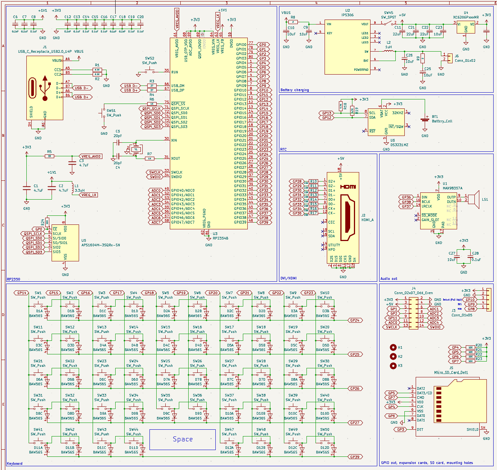
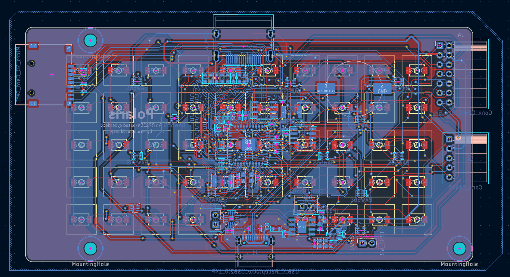
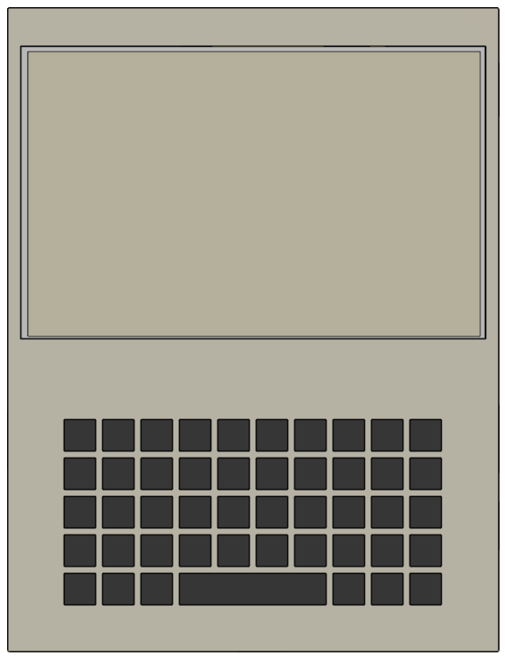

# Polaris

Polaris is a portable cyberdeck for everyday use. It does not use a Raspberry Pi or other SBC, but rather an RP2354B with extra PSRAM! It is meant for having an on-the-go device to use for everyday tasks.

## Features

- RP2354B SoC
- 520KB SRAM + 2MB PSRAM
- 2MB flash memory
- 5x10 thumb-size keyboard
- SD card slot
- USB-C port
- Battery charging with power path (IP2306)
- Audio output through speaker (MAX98357A)
- GPIO access
- Expansion port for apps

## Pictures

|Schematic|PCB|Case|
|---|---|---|
||||

## BOM

|Part|Quantity|Cost|Link|
|---|---|---|---|
|0402 20pF capacitor|2|$0.016|[LCSC](https://www.lcsc.com/product-detail/C1554.html)|
|0402 0.1uF capacitor|13|$0.072|[LCSC](https://www.lcsc.com/product-detail/C1525.html)|
|0402 4.7uF capacitor|3|$0.070|[LCSC](https://www.lcsc.com/product-detail/C23733.html)|
|0402 10uF capacitor|7|$0.181|[LCSC](https://www.lcsc.com/product-detail/C15525.html)|
|0603 22uF capacitor|3|$0.094|[LCSC](https://www.lcsc.com/product-detail/C59461.html)|
|0402 1uH inductor|1|$0.035|[LCSC](https://www.lcsc.com/product-detail/C84468.html)|
|0402 3.3uH inductor|1|$0.076|[LCSC](https://www.lcsc.com/product-detail/C84474.html)|
|0603 2Ω resistor|2|$0.006|[LCSC](https://www.lcsc.com/product-detail/C22977.html)|
|0603 27Ω resistor|2|$0.007|[LCSC](https://www.lcsc.com/product-detail/C25190.html)|
|0402 33Ω resistor|1|$0.008|[LCSC](https://www.lcsc.com/product-detail/C25105.html)|
|0603 220Ω resistor|8|$0.028|[LCSC](https://www.lcsc.com/product-detail/C22962.html)|
|0402 1KΩ resistor|2|$0.008|[LCSC](https://www.lcsc.com/product-detail/C11702.html)|
|0402 4.7KΩ resistor|2|$0.010|[LCSC](https://www.lcsc.com/product-detail/C25905.html)|
|0402 5.1KΩ resistor|2|$0.005|[LCSC](https://www.lcsc.com/product-detail/C25905.html)|
|0402 10KΩ resistor|5|$0.024|[LCSC](https://www.lcsc.com/product-detail/C25905.html)|
|BAW56S quad-diode package|12|$1.778|[LCSC](https://www.lcsc.com/product-detail/C426776.html)|
|USB-C receptacle, 14 pin|1|$0.172|[LCSC](https://www.lcsc.com/product-detail/C165948.html)|
|HDMI-A receptacle|1|$0.245|[LCSC](https://www.lcsc.com/product-detail/C720616.html)|
|microSD card receptacle|1|$0.061|[LCSC](https://www.lcsc.com/product-detail/C7529389.html)|
|3.9x2.9mm tactile switch|48|$1.627|[LCSC](https://www.lcsc.com/product-detail/C557591.html)|
|SPST rocker switch|1|$0.156|[LCSC](https://www.lcsc.com/product-detail/C6917318.html)|
|MAX98357A sound IC|1|$1.328|[LCSC](https://www.lcsc.com/product-detail/C910544.html)|
|Speaker|1|$0.995|[AliExpress](https://www.aliexpress.us/item/3256810283962305.html)|
|IP5306 battery charging IC|1|$0.299|[LCSC](https://www.lcsc.com/product-detail/C181692.html)|
|104050 3.7V 2500mAh LiPo battery|1|$8.790|[AliExpress](https://www.aliexpress.us/item/3256808739822835.html)|
|RP2354B|1|$1.551|[LCSC](https://www.lcsc.com/product-detail/C39843328.html)|
|XC6206P332MR 3.3V power regulator|1|$0.147|[LCSC](https://www.lcsc.com/product-detail/C5446.html)|
|APS1604M-3SQRx-SN 2MB PSRAM|1|$2.586|[LCSC](https://www.lcsc.com/product-detail/C18214056.html)|
|DS3231MZ real-time clock|1|$3.298|[LCSC](https://www.lcsc.com/product-detail/C107410.html)|
|CR1220 battery holder|1|$0.196|[LCSC](https://www.lcsc.com/product-detail/C964723.html)|
|12MHz 20pF crystal oscillator|1|$0.096|[LCSC](https://www.lcsc.com/product-detail/C9002.html)|
|1x5 right-angled pin header|1|$0.075|[LCSC](https://www.lcsc.com/product-detail/C54876734.html)|
|2x7 right-angled pin header|1|$0.328|[LCSC](https://www.lcsc.com/product-detail/C46061748.html)|
|5" 800x480 LCD display|1|$34.990|[Waveshare](https://www.waveshare.com/product/displays/lcd-oled/lcd-oled-1/5inch-hdmi-lcd.htm)|
|Total||$59.358||

## Notes

The firmware is still being developed. There will be more applications once the device is built.

Check `/firmware/src/main.cpp` for libraries/dependencies required to run the firmware.

PNP assembly files are provided if you'd want to get this assembled. The parts list is optimized for JLCPCB's Economic PCB assembly.

Have fun!